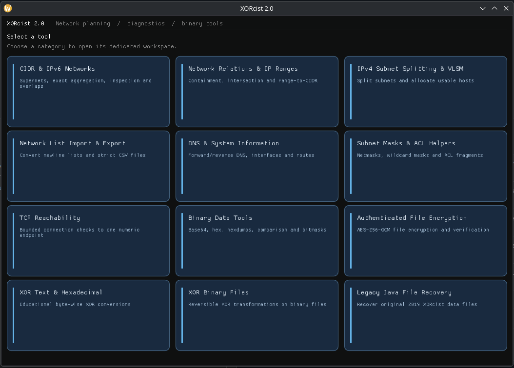
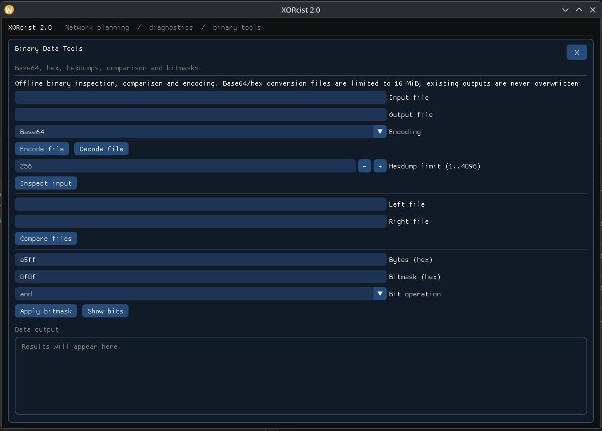

# XORcist 2.0

**A cross-platform C++20 toolkit for IP network planning, network diagnostics, binary analysis, and authenticated file encryption.**

[](https://github.com/SpilledMilkFactory/XORcist-2.0/actions/workflows/ci.yml)
[](https://github.com/SpilledMilkFactory/XORcist-2.0/releases/latest)
[](LICENSE)
[](CMakeLists.txt)

XORcist provides an offline-first set of tools for network administrators, engineers, and developers. Use it from a scriptable **command-line interface** or a **Dear ImGui desktop application**, both backed by the same C++ core. It focuses on address planning and targeted diagnostics rather than packet capture or sweeping networks.

> **Security:** The classic repeating-key XOR tools are educational transformations, **not secure encryption**. For authenticated files, XORcist has separate OpenSSL-backed AES-256-GCM commands. The project has not undergone an independent cryptographic security audit; see [SECURITY.md](SECURITY.md).



*The 12-tile dashboard is introduced in **v2.0.1**. The release link above always points to the latest **published** version; a version bump on `main` does not publish new binaries.*

## Get XORcist

**[Download the latest release](https://github.com/SpilledMilkFactory/XORcist-2.0/releases/latest)**

| Platform | Distribution | How to start |
| --- | --- | --- |
| Debian 12 / Debian 13 | Native `amd64` `.deb`, one for each distribution | Install the matching `.deb`; run `xorcist` or `xorcist-gui` |
| Ubuntu 24.04 / Ubuntu 26.04 | Native `amd64` `.deb`, one for each distribution | Install the matching `.deb`; run `xorcist` or `xorcist-gui` |
| Windows 10 / 11 | Portable x64 `.zip` | Extract; run `bin/xorcist.exe` or `bin/xorcist-gui.exe` |

**From v2.0.1 onward:** Download the archive matching your platform. The release contains **five platform archives and one `SHA256SUMS`** (plus GitHub's automatic source-code archives):

| Archive filename pattern | Contains |
| --- | --- |
| `XORcist-<version>-debian12-amd64.tar.gz` | Debian 12 `.deb`, SPDX, runtime inventory, checksums, Sigstore bundles |
| `XORcist-<version>-debian13-amd64.tar.gz` | Debian 13 `.deb` and associated verification files |
| `XORcist-<version>-ubuntu2404-amd64.tar.gz` | Ubuntu 24.04 `.deb` and associated verification files |
| `XORcist-<version>-ubuntu2604-amd64.tar.gz` | Ubuntu 26.04 `.deb` and associated verification files |
| `XORcist-<version>-windows-x64.zip` | Portable CLI and GUI executable tree, license notices, signed manifest |

On Linux, verify `SHA256SUMS`, then extract the archive for your distribution and install the enclosed `.deb`:

```bash
sha256sum -c SHA256SUMS
tar -xzf XORcist-<version>-ubuntu2604-amd64.tar.gz
cd XORcist-<version>-ubuntu2604-amd64
sudo apt install ./xorcist_<version>_amd64.deb
```

Windows users extract the ZIP once; both executables are under `bin/`. Each archive contains a **signed `RELEASE_MANIFEST.json`** and its `.sigstore.json` verification bundle. The manifest binds all included files to their hashes and source commit; the separately provided `SHA256SUMS` verifies archive bytes. See the [release guide](docs/M4_RELEASE_GUIDE.md) for signature verification instructions. The new archive layout applies only to newly built releases; the published v2.0.0 assets remain unchanged.

<details>
<summary>Installing from the original v2.0.0 release</summary>

The initial release provides separate `.deb` downloads and verification sidecars rather than consolidated platform archives. Select the correct distribution-specific `.deb` and install it directly, for example:

```bash
sudo apt install ./xorcist_2.0.0-1_ubuntu2604_amd64.deb
```

</details>

Do **not** interchange Linux distribution packages: their glibc, OpenSSL, and other runtime requirements may differ.

## What it does

| Area | Tools |
| --- | --- |
| **IP planning** | IPv4/IPv6 CIDR parsing and inspection; smallest enclosing supernets; exact aggregation; overlap, containment, and intersection; range-to-CIDR conversion; IPv4 subnet splitting and VLSM; network-list import/export. |
| **Diagnostics** | Forward/reverse DNS; read-only interfaces and routes; IPv4 netmask and wildcard conversion; Cisco-like ACL match fragments; explicitly bounded single-target TCP reachability checks. |
| **Binary utilities** | Base64 and hex file conversions; hexdump/ASCII inspection; streaming binary diff; bit masks and bit visualization. |
| **File transformations** | Educational bytewise XOR; decode-only recovery of the original Java XORcist `.dat` format. |
| **Authenticated files** | AES-256-GCM with scrypt-derived keys, randomized salt/nonce, authenticated versioned `.xorc3` container, and refusal to publish unauthenticated plaintext. |

The GUI organizes the tools into **12 labeled tiles**. Select a tile to open its workspace; close it with **X** or **Escape** to return to the dashboard. Workspaces retain inputs and results, and long results are scrollable.

<details>
<summary>See the Binary Data Tools workspace</summary>



</details>

### CLI examples

```bash
# A single enclosing network may include addresses outside the inputs.
xorcist net summarize 192.168.1.1/24 192.168.2.1/24 192.168.3.1/24
# Supernet: 192.168.0.0/22

# Exact aggregation adds no addresses.
xorcist net collapse 10.0.0.0/25 10.0.0.128/25 10.0.1.0/24
# 10.0.0.0/23

# IPv6 and capacity planning.
xorcist net inspect 2001:db8::1/64
xorcist net vlsm 10.0.0.0/24 lan=50 wifi=20 iot=5

# Local diagnostics; TCP probes are explicit, not network scans.
xorcist diag interfaces
xorcist diag dns localhost --family v4
xorcist diag probe 127.0.0.1 443 --count 1 --timeout-ms 500

# Reversible encodings and binary inspection.
xorcist data base64 encode --in input.bin --out encoded.txt
xorcist data inspect --in input.bin --limit 256

# Authenticated encryption; prompts for a passphrase without terminal echo.
xorcist secure encrypt --in input.bin --out protected.xorc3
xorcist secure decrypt --in protected.xorc3 --out restored.bin
```

Use `xorcist --help` for the full command reference, or `man xorcist` after Linux installation. Output paths are created without overwriting existing files.

## Build from source

Requirements: **C++20 compiler**, **CMake 3.20+**, OpenSSL **3.x** development files, and optional GLFW/OpenGL development files for the GUI. A Git checkout is used to fetch the pinned Dear ImGui source unless you provide a local source directory. Python 3 is recommended for the complete CTest suite.

**Debian / Ubuntu — CLI and tests:**

```bash
sudo apt install build-essential cmake ninja-build python3 libssl-dev
cmake -S . -B build-cli -G Ninja -DCMAKE_BUILD_TYPE=Release \
  -DXORCIST_BUILD_CLI=ON -DXORCIST_BUILD_GUI=OFF -DXORCIST_BUILD_TESTS=ON
cmake --build build-cli --parallel
ctest --test-dir build-cli --output-on-failure
./build-cli/xorcist --help
```

**Debian / Ubuntu — desktop GUI:**

```bash
sudo apt install build-essential cmake ninja-build git python3 libssl-dev \
  libglfw3-dev libgl1-mesa-dev
cmake -S . -B build-gui -G Ninja -DCMAKE_BUILD_TYPE=Release \
  -DXORCIST_BUILD_GUI=ON -DXORCIST_BUILD_TESTS=ON -DXORCIST_FETCH_GLFW=OFF
cmake --build build-gui --parallel
ctest --test-dir build-gui --output-on-failure
./build-gui/xorcist-gui
```

For Windows source builds, use Visual Studio 2022 with a C++20 toolchain and provide OpenSSL 3.x/GLFW dependencies (the [release workflow](.github/workflows/m4-candidates.yml) documents the pinned MSVC/vcpkg path). The CLI and GUI are separate targets; headless systems do not need graphical dependencies.

## Architecture and verification

```text
include/xorcist/  Public core APIs
src/core/         Networking, diagnostics, binary tools, and cryptography
src/cli/          CLI commands; calls the shared core
src/gui/          Dear ImGui / GLFW / OpenGL frontend; calls the same core
tests/            Regression, property-based, integration, and fuzz tests
cmake/            Pinned dependencies and package staging safeguards
packaging/linux/  Linux desktop integration
scripts/          Candidate packaging, audits, and integrity checks
docs/             Technical specifications, release guides, and licenses
.github/workflows/  CI and signed platform-candidate builds
```

The initial **v2.0.0** release passed the GitHub Actions candidate matrix for Debian 12/13, Ubuntu 24.04/26.04, and Windows x64, including artifact signing and verification. The maintainer reports installation and functional testing on fresh VMs for all supported targets. The **v2.0.1 source** is prepared for an independent qualification run; existing v2.0.0 binaries and signatures are not reused. This is *release engineering evidence*, **not** independent security certification. See [VERIFICATION.md](VERIFICATION.md) for the scope and limits of testing, and [docs/ROADMAP.md](docs/ROADMAP.md) for ongoing development.

## Project history and license

XORcist began as a Java cybersecurity class project in 2019. Version 2.0 is a ground-up C++20 rebuild emphasizing deterministic networking algorithms, testable core logic, explicit security boundaries, and reproducible distribution. The original code remains available in the [2019 XORcist repository](https://github.com/SpilledMilkFactory/XORcist); see the [legacy-code audit](docs/2019_AUDIT.md) for compatibility details.

XORcist's original source is licensed under the **[MIT License](LICENSE)**. Dear ImGui, GLFW, and OpenSSL retain their own licenses; see [THIRD_PARTY_NOTICES.md](THIRD_PARTY_NOTICES.md) and [`docs/licenses/`](docs/licenses/).

For bugs and feature requests, use [GitHub Issues](https://github.com/SpilledMilkFactory/XORcist-2.0/issues). Please report suspected vulnerabilities **privately**, as described in [SECURITY.md](SECURITY.md).
